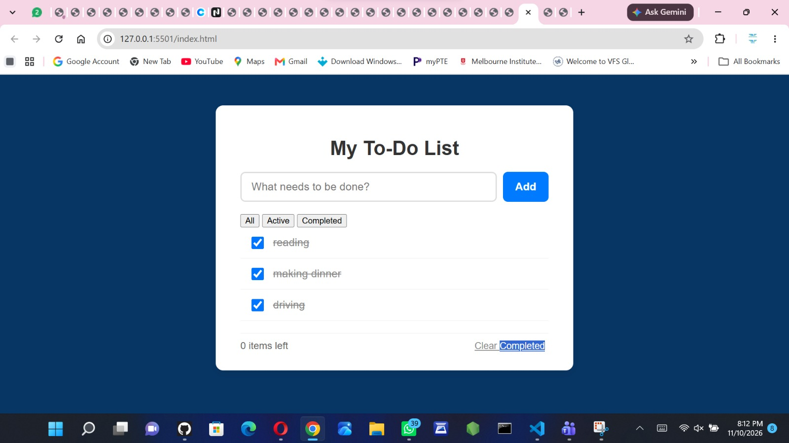

# Week {Number}: {Project Title}

## Author
- **Name:** Your Full Name
- **GitHub:** [@Caroline-wanjira](https://github.com/Caroline-wanjira)
- **Date:** 9th November, 2026

## Project Description
I built a simple,rensponsive To-Do List web application. I built it to get hand on experience with DOM Manipulation in JS.

## Technologies Used
- HTML5
- CSS3
- JavaScript
- VS code with live server
- git and github

## Features
- **Filter Tasks:** Switch views between **All**, **Active**, and **Completed** items.
- **Item Counter:** Shows how many active tasks are left.
- **Clear Completed:** One-click button to clear out finished items.
- **Delete Tasks:** Hover over any item to reveal its delete button.

## How to Run
1. Clone this repository:
   ```bash
   git clone [https://github.com/caroline-wanjira/iyf-s12-week-05-Caroline-wanjira.git](https://github.com/caroline-wanjira/iyf-s12-week-05-Caroline-wanjira.git)

## Lessons Learned
- **DOM Manipulation Methods:** Got comfortable using native methods like `createElement`, `appendChild`, and `closest()` to target and manipulate elements efficiently.

## Challenges Faced
- Newly added tasks weren't responding to clicks because event listeners were only running when the page first loaded. I Switched to event delegation on the parent list, checking  to figure out whether the I had clicked the delete button or the checkbox.

## Screenshots (optional)


## Live Demo (if deployed)
[To-Do List]( https://caroline-wanjira.github.io/iyf-s12-week-05-Caroline-wanjira/)
